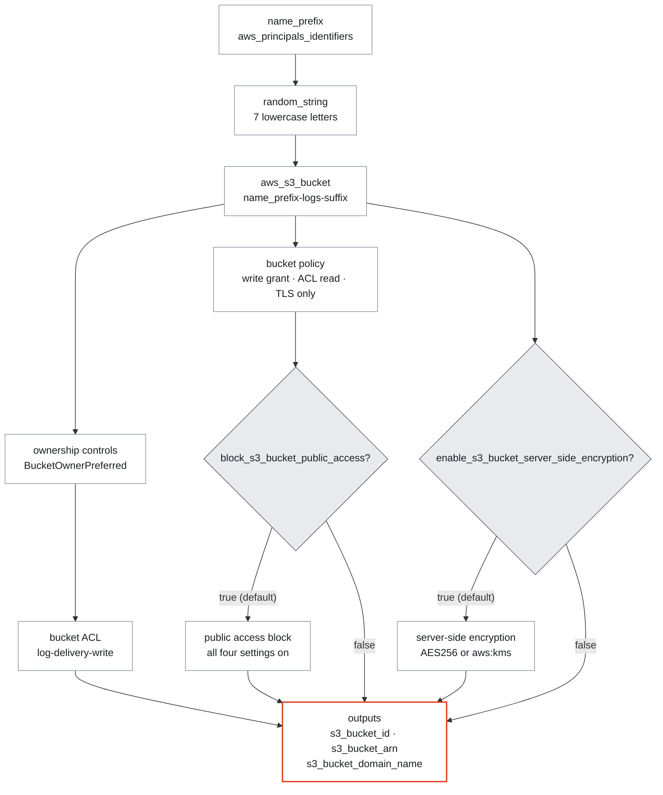
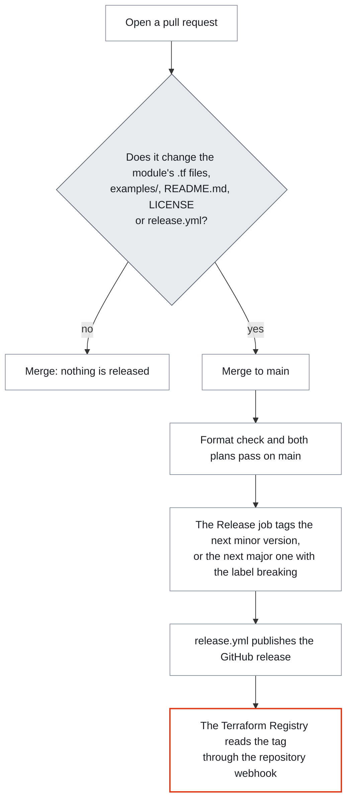

<div align="center">


# 🪣 terraform-aws-s3-bucket

### An S3 bucket for access logs, locked down by default.

**A Terraform and OpenTofu module that creates one S3 bucket meant to receive access logs.** It
blocks public access, turns on server-side encryption, denies any request that doesn't use TLS and
sets the `log-delivery-write` ACL, so you don't have to remember those four things each time.

<br>

[](https://registry.terraform.io/modules/agusgonzaleznic/s3-bucket/aws)
[](https://github.com/agusgonzaleznic/terraform-aws-s3-bucket/releases)
<br>


<br>


<br>

**[Quick start](#-quick-start) · [What it builds](#-what-it-builds) · [Defaults](#-the-defaults) · [Limits](#-what-it-doesnt-do) · [Reference](#-reference) · [CI](#-what-ci-checks) · [Contributing](#-contributing) · [Releases](#-how-a-release-happens) · [Support](#-support-this-project) · [Licence](#-licence)**

</div>

---

## 🧭 What this is

The module is for S3 server access logs and for load balancer access logs. The bucket policy, the
ownership setting, the ACL, the public access block and the encryption are easy to get slightly
wrong one at a time, so the module sets them together and gives you three outputs: the bucket's
ID, ARN and domain name.

It works with both [Terraform](https://www.terraform.io/) and [OpenTofu](https://opentofu.org/).
The Terraform Registry page is
[agusgonzaleznic/s3-bucket/aws](https://registry.terraform.io/modules/agusgonzaleznic/s3-bucket/aws),
and every release lands there by itself (see [how a release happens](#-how-a-release-happens)).

## ⚡ Quick start

```hcl
module "logs_bucket" {
  source  = "agusgonzaleznic/s3-bucket/aws"
  version = "~> 1.0"

  name_prefix                = "my-app"
  aws_principals_identifiers = ["arn:aws:iam::123456789012:root"]
}
```

Two inputs are required. `name_prefix` becomes the start of the bucket name, and
`aws_principals_identifiers` lists the AWS principals allowed to write log objects into the bucket.
Everything else has a default, listed in the [reference](#-reference).

OpenTofu's registry doesn't list the module (as of 14 November 2026), so with OpenTofu use the Git
source with a release tag and drop the `version` line:

```hcl
  source = "git::https://github.com/agusgonzaleznic/terraform-aws-s3-bucket.git?ref=v1.1.0"
```

For S3 server access logs, nothing more is needed: the `log-delivery-write` ACL lets S3's log
delivery group write. For load balancer access logs, put your Region's Elastic Load Balancing
account in `aws_principals_identifiers` (for example `arn:aws:iam::054676820928:root` in Frankfurt;
AWS lists them on its
[access logs page](https://docs.aws.amazon.com/elasticloadbalancing/latest/application/enable-access-logging.html)).
That's AWS's legacy policy, which only Regions available before August 2022 accept.

[`examples/test`](https://github.com/agusgonzaleznic/terraform-aws-s3-bucket/tree/main/examples/test) is the example CI plans. Its provider points every AWS endpoint at
LocalStack on `localhost:4566`, so it doesn't run against a real account.

## 📦 What it builds



| Resource | Created | What it does |
|---|---|---|
| `random_string.random` | always | Seven lowercase letters, regenerated when `name_prefix` changes |
| `aws_s3_bucket.logs` | always | Named `<name_prefix>-logs-<seven letters>` in lowercase, tagged with your `tags` plus a `Name` tag |
| `aws_s3_bucket_ownership_controls.logs` | always | Sets object ownership to `BucketOwnerPreferred` |
| `aws_s3_bucket_acl.logs` | always | Sets the `log-delivery-write` ACL, after the ownership controls exist |
| `aws_s3_bucket_policy.logs_access_policy` | always | Three statements, described below |
| `aws_s3_bucket_public_access_block.logs_block_public_access` | `block_s3_bucket_public_access` is `true` | Turns on `block_public_acls`, `block_public_policy`, `ignore_public_acls` and `restrict_public_buckets` |
| `aws_s3_bucket_server_side_encryption_configuration.logs` | `enable_s3_bucket_server_side_encryption` is `true` | Applies the chosen algorithm, and the KMS key only when the algorithm is `aws:kms` |

Changing `name_prefix` gives the bucket a new name and a new random suffix, so Terraform replaces
it. With `s3_bucket_force_destroy` left at `false`, that fails while the old bucket still holds logs.

## 🔒 The defaults

The bucket policy has three statements:

| Statement | Effect | Who | Action |
|---|---|---|---|
| Write access | Allow | The principals in `aws_principals_identifiers`; the current account's ID if you pass an empty list | `s3:PutObject` on every object in the bucket |
| ACL read | Allow | The service `logdelivery.elb.amazonaws.com` | `s3:GetBucketAcl` on the bucket |
| `https-only` | Deny | Everyone | `s3:*` on the bucket and its objects, when `aws:SecureTransport` is false |

No statement grants public read. The switches and what they change:

| Input | Default | Turn it off and |
|---|---|---|
| `block_s3_bucket_public_access` | `true` | the module no longer creates the public access block |
| `enable_s3_bucket_server_side_encryption` | `true` | the module no longer creates an encryption configuration |
| `s3_bucket_force_destroy` | `false` | with `true`, Terraform can delete the bucket even when it still holds objects |

For KMS, set `s3_bucket_server_side_encryption_sse_algorithm = "aws:kms"` and pass a key in
`s3_bucket_server_side_encryption_key`. Without a key, S3 uses the default `aws/s3` key. With the
`AES256` default, the key input is ignored. Keep `AES256` for S3 server access logs and load
balancer access logs: AWS delivers both only to buckets encrypted with S3-managed keys.

## 🧱 What it doesn't do

- **No lifecycle rules.** Logs stay until you delete them.
- **No versioning, replication or object lock.**
- **No logging of its own.** The module configures the destination. It doesn't switch on logging for
  any service, and it doesn't log access to the bucket itself.
- **No KMS key.** With `aws:kms` you bring an existing key, and I don't touch its key policy.
- **No service principals.** The write statement only takes AWS principals, so a service that
  delivers as a service principal, such as `logdelivery.elasticloadbalancing.amazonaws.com`, gets no
  write access. The module manages the bucket's only policy, so you can't add one next to it.
- **One bucket per call.** You choose the prefix, and the module chooses the rest of the name.
- **No real-account testing in CI.** The pipeline plans against LocalStack and never applies. See
  [what CI checks](#-what-ci-checks).

## 📘 Reference

The block between the markers below is generated by the `terraform_docs` pre-commit hook from the
module's `.tf` files. I don't edit it by hand.

<!-- BEGINNING OF PRE-COMMIT-TERRAFORM DOCS HOOK -->
## Requirements

| Name | Version |
| ---- | ------- |
| <a name="requirement_terraform"></a> [terraform](#requirement\_terraform) | >= 1.6 |
| <a name="requirement_aws"></a> [aws](#requirement\_aws) | >= 5.30 |

## Providers

| Name | Version |
| ---- | ------- |
| <a name="provider_aws"></a> [aws](#provider\_aws) | >= 5.30 |
| <a name="provider_random"></a> [random](#provider\_random) | n/a |

## Modules

No modules.

## Resources

| Name | Type |
| ---- | ---- |
| [aws_s3_bucket.logs](https://registry.terraform.io/providers/hashicorp/aws/latest/docs/resources/s3_bucket) | resource |
| [aws_s3_bucket_acl.logs](https://registry.terraform.io/providers/hashicorp/aws/latest/docs/resources/s3_bucket_acl) | resource |
| [aws_s3_bucket_ownership_controls.logs](https://registry.terraform.io/providers/hashicorp/aws/latest/docs/resources/s3_bucket_ownership_controls) | resource |
| [aws_s3_bucket_policy.logs_access_policy](https://registry.terraform.io/providers/hashicorp/aws/latest/docs/resources/s3_bucket_policy) | resource |
| [aws_s3_bucket_public_access_block.logs_block_public_access](https://registry.terraform.io/providers/hashicorp/aws/latest/docs/resources/s3_bucket_public_access_block) | resource |
| [aws_s3_bucket_server_side_encryption_configuration.logs](https://registry.terraform.io/providers/hashicorp/aws/latest/docs/resources/s3_bucket_server_side_encryption_configuration) | resource |
| [random_string.random](https://registry.terraform.io/providers/hashicorp/random/latest/docs/resources/string) | resource |
| [aws_caller_identity.current](https://registry.terraform.io/providers/hashicorp/aws/latest/docs/data-sources/caller_identity) | data source |
| [aws_iam_policy_document.logs_access_policy_document](https://registry.terraform.io/providers/hashicorp/aws/latest/docs/data-sources/iam_policy_document) | data source |

## Inputs

| Name | Description | Type | Default | Required |
| ---- | ----------- | ---- | ------- | :------: |
| <a name="input_aws_principals_identifiers"></a> [aws\_principals\_identifiers](#input\_aws\_principals\_identifiers) | List of identifiers for AWS principals with access to write in the logs bucket | `list(string)` | n/a | yes |
| <a name="input_block_s3_bucket_public_access"></a> [block\_s3\_bucket\_public\_access](#input\_block\_s3\_bucket\_public\_access) | (Optional) If true, public access to the S3 bucket will be blocked. | `bool` | `true` | no |
| <a name="input_enable_s3_bucket_server_side_encryption"></a> [enable\_s3\_bucket\_server\_side\_encryption](#input\_enable\_s3\_bucket\_server\_side\_encryption) | (Optional) If true, server side encryption will be applied. | `bool` | `true` | no |
| <a name="input_name_prefix"></a> [name\_prefix](#input\_name\_prefix) | Name prefix for resources on AWS | `string` | n/a | yes |
| <a name="input_s3_bucket_force_destroy"></a> [s3\_bucket\_force\_destroy](#input\_s3\_bucket\_force\_destroy) | (Optional) Sets force\_destroy attribute on the generated S3 bucket. | `bool` | `false` | no |
| <a name="input_s3_bucket_server_side_encryption_key"></a> [s3\_bucket\_server\_side\_encryption\_key](#input\_s3\_bucket\_server\_side\_encryption\_key) | (Optional) The AWS KMS master key ID used for the SSE-KMS encryption. This can only be used when you set the value of sse\_algorithm as aws:kms. The default aws/s3 AWS KMS master key is used if this element is absent while the sse\_algorithm is aws:kms. | `string` | `null` | no |
| <a name="input_s3_bucket_server_side_encryption_sse_algorithm"></a> [s3\_bucket\_server\_side\_encryption\_sse\_algorithm](#input\_s3\_bucket\_server\_side\_encryption\_sse\_algorithm) | (Optional) The server-side encryption algorithm to use. Valid values are AES256 and aws:kms | `string` | `"AES256"` | no |
| <a name="input_tags"></a> [tags](#input\_tags) | Resource tags | `map(string)` | `{}` | no |

## Outputs

| Name | Description |
| ---- | ----------- |
| <a name="output_s3_bucket_arn"></a> [s3\_bucket\_arn](#output\_s3\_bucket\_arn) | Logging S3 Bucket ARN |
| <a name="output_s3_bucket_domain_name"></a> [s3\_bucket\_domain\_name](#output\_s3\_bucket\_domain\_name) | Logging S3 Bucket Domain Name |
| <a name="output_s3_bucket_id"></a> [s3\_bucket\_id](#output\_s3\_bucket\_id) | Logging S3 Bucket ID |
<!-- END OF PRE-COMMIT-TERRAFORM DOCS HOOK -->

## 🧪 What CI checks

The pipeline in `.github/workflows/pipeline.yml` runs on every push to `main` and every pull request
to `main`. As of 14 November 2026 it runs these jobs:

| Job | Runs | With |
|---|---|---|
| Format check | `terraform fmt -check -recursive -diff` | Terraform 1.15.7 |
| Terraform on `examples/test` | `init -upgrade`, `validate`, then `plan -input=false` | Terraform 1.15.7, against LocalStack 4.5.0 |
| OpenTofu on `examples/test` | `init -upgrade`, `validate`, then `plan -input=false` | OpenTofu 1.12.3, against LocalStack 4.5.0 |
| Release | On a pull request, says what the merge releases; on `main`, tags and releases it | The shared `version-tag.yml` |

The plan is a mock: the example points the AWS provider at LocalStack and the pipeline sets dummy
credentials, so it shows the module is valid and plans on both tools. It doesn't apply anything and
it doesn't prove behaviour in a real account. The module declares `>= 1.6` for both tools, and CI
doesn't run the older versions. `init -upgrade` picks the newest AWS provider that the `>= 5.30`
constraint allows. The run on `main` on 16 September 2026 installed AWS provider 6.64.0 and
planned on both tools.

Dependabot checks the Terraform files and the GitHub Actions weekly, and the repository has a Renovate
configuration too. GitHub's CodeQL default setup also scans the workflow files.

## 🤝 Contributing

Issues and pull requests are welcome on
[GitHub](https://github.com/agusgonzaleznic/terraform-aws-s3-bucket). Please install the pre-commit
hooks right after cloning:

```sh
pre-commit install
```

The hooks in `.pre-commit-config.yaml` run `terraform fmt`, `tflint`, `terraform validate`, Trivy,
Checkov and `terraform-docs`, plus general checks (merge conflicts, trailing whitespace, JSON and
YAML syntax, AWS credentials and private keys). They call those tools, so install them and
[pre-commit](https://pre-commit.com/) first. The hooks also refuse a commit on `main`, so work on a
branch. To run every check on your branch:

```sh
pre-commit run --all-files
```

To run the hooks against OpenTofu instead of Terraform, export `PCT_TFPATH=$(command -v tofu)`.

## 🔁 How a release happens

The merge of a pull request is the release. Nobody pushes a tag by hand.



- Every pull request gets the check `Release / Check the version`, which says what its merge
  releases. The registry shows this README, so a change to it is released too.
- The version comes from the newest tag: `1.0.0`, tagged by hand in December 2023, was the last one
  without the `v`. A ruleset keeps `v*` tags from being moved or deleted.
- The release notes list the pull requests merged since the previous tag.

## 💛 Support this project

The module is free and stays free. If it saved you an afternoon, there are two easy ways to say
thanks: star the repo, or send a coffee. Ko-fi is a one-off, and GitHub Sponsors can be monthly or
one-time, with a custom amount.

<div align="center">
<br>

[](https://ko-fi.com/agusgonzaleznic)
[](https://github.com/sponsors/agusgonzaleznic)
<br>
[](https://agusgonzaleznic.com)
[](https://github.com/agusgonzaleznic)
[](https://www.linkedin.com/in/agusgonzaleznic)

<br>

<sub>Built in Berlin by <b>Agustin Gonzalez Nicolini</b>. I work on engineering leadership and write
about it at <a href="https://agusgonzaleznic.com">agusgonzaleznic.com</a>.</sub>

</div>

---

## 📄 Licence

Apache License 2.0. See [`LICENSE`](https://github.com/agusgonzaleznic/terraform-aws-s3-bucket/blob/main/LICENSE).
